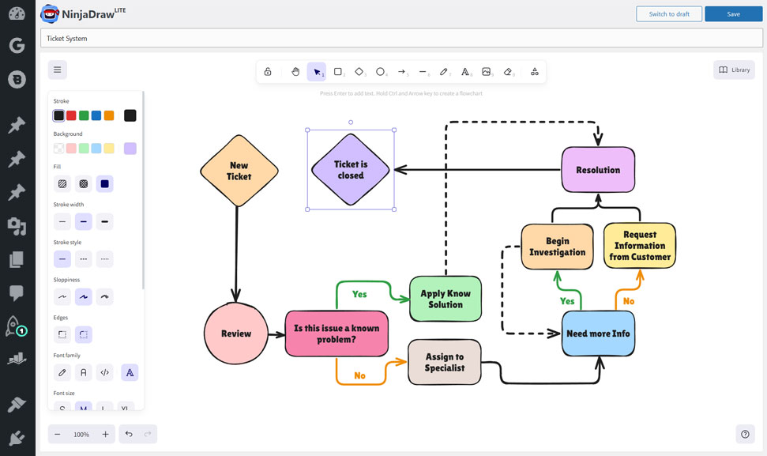

# NinjaDraw - Diagram, Flowchart, Mind Map & Sketching Tool

Create flowcharts, diagrams, wireframes, and hand-drawn sketches directly inside WordPress. NinjaDraw brings an intuitive Excalidraw-powered whiteboard canvas to your block editor, turning complex ideas into visual workflows.

## About this repository

This repository contains the **exact free version published on [WordPress.org](https://wordpress.org/plugins/ninjadraw/)** - the JS and CSS assets here are intentionally **not minified or obfuscated**, so you can read and audit every line the plugin runs on your site. The Pro version is distributed separately via [yalogica.com](https://yalogica.com/ninjadraw/).

## Description

NinjaDraw is a WordPress plugin that adds a hand-drawn style diagram editor based on Excalidraw, no coding required. Draw rectangles, diamonds, ellipses, arrows, lines, and text with a full undo/redo history, then embed the result anywhere with a Gutenberg block or the `[ninjadraw id="123"]` shortcode. On the frontend your site only serves lightweight, optimized SVG files - no heavy external scripts, layout shifts, or bulky base64 data, keeping your pages fast and GDPR-friendly.

- [Documentation](https://yalogica.com/docs/ninjadraw/)
- [Upgrade to Pro](https://yalogica.com/ninjadraw/)

### Free version highlights

- Unlimited diagrams
- Hand-drawn Excalidraw canvas: rectangle, diamond, ellipse, arrow, line
- Smart undo/redo history
- Export diagrams as PNG or SVG
- Reusable element library
- Shortcode & Gutenberg block support
- Works with all major page builders (Elementor, Divi, Beaver, Bricks, and more)
- Responsive, SEO-friendly lightweight SVG output
- 100% GDPR-compliant, no tracking or external servers

**NinjaDraw Pro** adds image canvas support (insert images from the WordPress Media Library), native .excalidraw file import and editing, the frame tool for grouping elements into clean layout frames, interactive web embeds, the laser pointer tool for live presentations, Mermaid import to turn text scripts into flowcharts, plus global settings and user permissions to manage your whole team.

## Installation

The canonical, always-up-to-date build lives in the WordPress.org directory:

1. In your WordPress admin, go to **Plugins → Add New**.
2. Search for "NinjaDraw".
3. Click **Install Now**, then **Activate**.
4. Embed diagrams with the Gutenberg block or the `[ninjadraw id="123"]` shortcode.

Or download the installable zip directly from
[wordpress.org/plugins/ninjadraw](https://wordpress.org/plugins/ninjadraw/).

## Support

- **Usage & installation help:** use the [WordPress.org support forum](https://wordpress.org/support/plugin/ninjadraw/) - this is the fastest way to get an answer.
- **GitHub Issues:** for reproducible bugs in the source code published in this repository only.